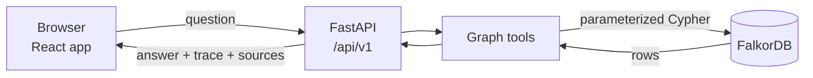

# WorkCity: The Living Company Brain

**Graph Hacks (WeMakeDevs x FalkorDB) | Track 3: Company Brain**

WorkCity connects a company's people, projects, systems, decisions, documents, incidents, tickets and chat threads in one FalkorDB graph. Ask a question like *"Who knows the payment service best?"* and the answer is built from real graph connections, with the reasoning shown next to it. The demo company is a fictional one called **NovaWorks**.

---

## Run it (3 steps)

**You need:** [Docker Desktop](https://www.docker.com/products/docker-desktop/) installed and **running**, Git, and an internet connection for the first build. Nothing else (no Python, Node or API keys).

**1. Get the code**

```bash
git clone https://github.com/mrpiyushgupta/Company-brain.git
cd Company-brain
```

Make sure you are in the folder that contains `docker-compose.yml` (check with `ls` on Mac/Linux or `dir` on Windows).

**2. Start everything**

```bash
docker compose up --build
```

The first build takes a few minutes. It is finished when the log shows both of these lines:

```
Graph seeded successfully.
Application startup complete.
```

**3. Open the app**

Go to **http://localhost:8000**

If the city looks empty, wait about 10 seconds for the graph to finish seeding and refresh the page.

**Check that it works** (optional, in a second terminal):

```bash
curl http://localhost:8000/api/v1/health
```

You should see `"falkordb_connected": true` and a `node_count` above 0.

**Stop it**

Press `Ctrl + C`, then:

```bash
docker compose down        # keeps the graph data
docker compose down -v     # also deletes the graph data (it re-seeds on the next start)
```

---

## If it does not open

| Problem | Fix |
|---|---|
| `Cannot connect to the Docker daemon` or similar | Start Docker Desktop and wait until it says it is running, then run the command again. |
| `no configuration file provided: not found` | You are in the wrong folder. `cd` into the folder that contains `docker-compose.yml`. |
| `port is already allocated` / port 8000 busy | In `docker-compose.yml` change `"8000:8000"` to `"8080:8000"`, then open http://localhost:8080. |
| Page is blank or the city is empty | Wait for `Graph seeded successfully.` in the logs, then refresh. |
| Old data or a stuck state | Run `docker compose down -v`, then `docker compose up --build` again. |
| Build fails while downloading packages | Check your internet connection and run the command again. |

To see what is happening, run `docker compose ps` and `docker compose logs app --tail 80`.

---

## What you can do in the app

- **Ask WorkCity:** ask plain-English questions. Each answer comes from Cypher queries on FalkorDB and shows how it was found.
- **City View:** the company as a city. Districts are departments and buildings are projects. Filter by status (Active, Delayed, Planning) and click a project or a person for details.
- **Graph Explorer:** pick any entity, see its connections, expand its neighborhood, and find the path between two entities.
- **Decision trace:** follows `SUPERSEDES` links to show which decision is current, who made it, and which document records it.
- **Document ingestion:** add a document through the API (`POST /api/v1/ingest/document`). References to known entities, such as decision, incident or system IDs, are linked into the graph.
- **Works without any LLM:** a built-in agent answers from graph queries.

### Try these questions

In the **Ask WorkCity** tab:

1. Who knows the payment service best?
2. Why was Project Atlas delayed?
3. Which decision supersedes DEC-202?
4. What could break if core-db goes down?
5. Who is the most central employee in the company?
6. What changed in the last 30 days?

---

## How it works



1. The question goes to the assistant in the FastAPI backend.
2. The assistant picks one or more graph tools and runs them on FalkorDB.
3. The answer text, evidence path and sources are built from the rows that come back.
4. The UI shows the answer together with how it was found.

### Graph tools

| Tool | What it does |
|---|---|
| `find_entity` | Finds an entity by id, name or title |
| `neighbors` | Returns the connections of an entity (1 or 2 hops) |
| `shortest_path` | Finds how two entities are connected |
| `who_knows` | Ranks people for a system or project using weighted paths (owns, resolved incidents, authored documents, project work, chat mentions) |
| `decision_trace` | Follows a decision to its maker, documents, and what supersedes it |
| `blast_radius` | Finds what depends on a system |
| `central_nodes` | Finds the most connected nodes |
| `search_documents` | Searches documents, tickets and chat threads |
| `recent_changes` | Lists recently created or updated items |

### Graph model

**Nodes:** Employee, Department, Skill, Project, System, Document, Decision, Incident, Ticket, ChatThread, Session, Question, Answer

**Relationships (examples):** `BELONGS_TO`, `REPORTS_TO`, `WORKED_ON`, `OWNS`, `HAS_SKILL`, `USES`, `DEPENDS_ON`, `AFFECTED`, `RESOLVED_BY`, `DOCUMENTED_IN`, `AUTHORED`, `MADE`, `COLLABORATES_WITH`, `ASSIGNED_TO`, `PARTICIPATED_IN`, `MENTIONS`, `SUPERSEDES`

---

## Optional: use an LLM

The app works without one. To try an OpenAI-compatible model (for example a local model through Ollama or LM Studio), copy `.env.example` to `.env` in the project folder, fill in the values, and restart with `docker compose up --build`:

```env
LLM_BASE_URL=http://host.docker.internal:11434/v1
LLM_MODEL=qwen2.5:7b
LLM_API_KEY=
```

If the model is unreachable, the app falls back to the built-in agent.

---

## Run without Docker for the app (advanced)

FalkorDB still runs in Docker. You also need Python 3.12+ and Node 20+.

```bash
# 1. FalkorDB
docker run -p 6379:6379 -d falkordb/falkordb:latest

# 2. Build the frontend once
cd frontend
npm install
npm run build
cd ..

# 3. Start the backend (serves the built app at http://localhost:8000)
cd backend
pip install -r requirements.txt
```

Then start the server:

```bash
# Mac / Linux
FALKORDB_HOST=localhost python -m uvicorn app.main:app --port 8000
```

```powershell
# Windows PowerShell
$env:FALKORDB_HOST="localhost"; python -m uvicorn app.main:app --port 8000
```

Open http://localhost:8000.

---

## Project structure

```
.
├── backend/            FastAPI app, graph tools, assistant, seed data loader
├── frontend/           React + Vite + TypeScript + Tailwind
├── data/               seed_data.json and sample documents
├── Dockerfile          builds the frontend, then serves it from FastAPI
└── docker-compose.yml  app + FalkorDB
```

**API endpoints** (under `/api/v1`): `/health`, `/city`, `/employees`, `/projects`, `/systems`, `/documents`, `/decisions`, `/incidents`, `/graph/neighborhood/{id}`, `/graph/path`, `/assistant/ask`, `/sessions/{id}`, `/ingest/document`, `/ingest/json`

**Configuration:** `FALKORDB_HOST` (default `falkordb` in Docker), `FALKORDB_PORT` (`6379`), `GRAPH_NAME` (`workcity_novaworks`), and the optional `LLM_BASE_URL`, `LLM_MODEL`, `LLM_API_KEY`.

---

## Built with

FalkorDB, FastAPI, React, Vite, TypeScript, Tailwind CSS, Docker Compose

## License

See `LICENSE`.
